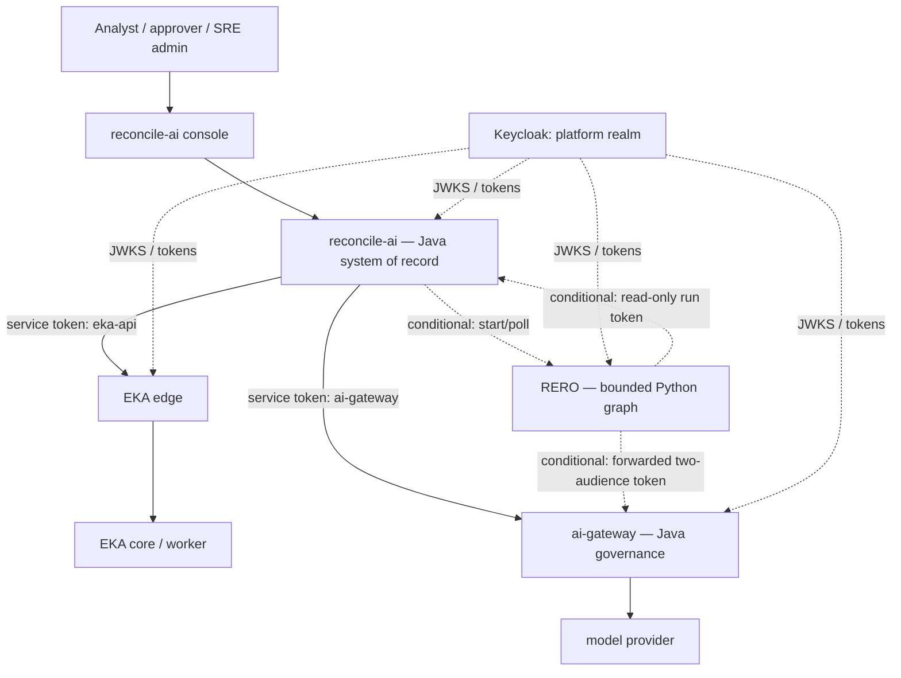

> **Copy of a private repository document**, snapshot taken 2026-11-17. The source code is private, so links to files in the repository are shown as plain paths. Status labels are the author's own, as written at the time of the snapshot. All data is synthetic.

# Integration Technical Design Document
## Three-service baseline with conditional RERO

| Field | Value |
|---|---|
| Version | 2.1 draft — 2026-11-14 (agreed fixes 1–8 applied inline) |
| Source boundary | Existing capabilities are assertions from platform facts until verified in the evidence register. New integration behavior is proposed. |
| Design order | Q1 EKA, Q2 ai-gateway, Q3 RERO only if retained, Q4 evidence/demo. |

## 1. Architecture



### 1.1 Authority boundaries

| Component | Owns | Must never do |
|---|---|---|
| reconcile-ai | Breaks, evidence, proposals, approvals, policy gate, audit, resolution | Delegate a ledger write or final decision to a model/service. |
| EKA | Document ingestion and owner-isolated retrieval | Know break business semantics or create a proposal. |
| ai-gateway | Chat-completion policy, budgeting, idempotency, ledger, telemetry | Authorize business data, retrieve knowledge, or make reconciliation decisions. |
| RERO, conditional | Fixed recommendation workflow and minimal result retention | Write, approve, route, resolve, or reach EKA directly. |

`ResolutionCommitService` remains reachable only through the existing approval path. Feature flags for knowledge, gateway, and RERO default to `false`. Integrated demo configuration keeps auto-resolution disabled.

## 2. Identity and trust

### 2.1 Shared realm and audiences

The platform realm uses RS256 because the Java services require it. The following are target contracts and must be proven by S-1/S-3 before reliance.

| Caller → resource | Credential | Required audience | Required claims |
|---|---|---|---|
| Browser → reconcile-ai | User JWT | `reconcile-api` | `tenant_id`, `sub`, roles |
| reconcile-ai → EKA edge | Service JWT | `eka-api` | stable `sub`, permitted role; tenant derives from service identity |
| reconcile-ai → ai-gateway | Service JWT | `ai-gateway` | `tenant_id`, `sub`, `GATEWAY_CONSUMER` |
| reconcile-ai → RERO, conditional | Service JWT | `rero-api` + `ai-gateway` | `tenant_id`, `sub`, `RERO_CALLER`, `GATEWAY_CONSUMER` |
| RERO → reconcile-ai internal, conditional | Run capability JWT | `reconcile-internal` | `tenant_id`, `job_id`, `scope=tools:read`, expiry |

Users are never forwarded. `reconcile-ai` caches service tokens by `(tenant, audience set)` only until shortly before expiry. Secrets are deployment-provided, never logged.

### 2.2 Conditional two-audience exception

Only if RERO is retained, it receives a short-lived service token carrying `rero-api` and `ai-gateway`, then forwards it to ai-gateway because the gateway derives tenant identity from that JWT. This is an explicit v1 exception, not “one audience per service.” Its compensating controls are: short TTL, fixed model/task policy, tenant budget, service-only network egress, and no EKA audience. Token exchange is deferred.

### 2.3 Run capability token

If RERO exists, `reconcile-ai` mints an ES256 run token for one job:

```text
iss=reconcile-ai; aud=reconcile-internal; sub=rero
claims: tenant_id, job_id, scope=tools:read, jti, iat, exp
```

The internal security chain verifies signature, issuer, audience, expiry, scope, matching path job ID, RERO mode, and `RUNNING` job state. The latter is **server-side job-state invalidation**: a terminal or cancelled job rejects tool access. It is not JWT revocation and no deny-list is claimed.

## 3. Shared conventions

- New contracts use ISO-8601 UTC and decimal-string money values.
- Correlation uses W3C `traceparent`; `reconcile-ai` also persists `jobId`, gateway idempotency key, and `invocationId` when available.
- Logs/traces/metrics contain IDs, sizes, status, and latency only; never prompts, evidence, model text, tokens, or raw sensitive matches.
- No tenant ID is a metric label.
- Contract schemas reside in `platform/contracts/`, have explicit `$id` and version, and are validated by provider and consumer tests. `platform` is a private repo holding contracts, Compose files, docs and evidence. Compose finds the service repos through `RECONCILE_AI_DIR`, `EKA_DIR` and `GATEWAY_DIR`, because the repos live in different folders.
- Caller-side retry of a downstream call is at most **1**, with the same idempotency key, and only if the job deadline still allows it.
- All timeouts, limits, and budgets begin as configuration values and become claimed defaults only after recorded measurement.

## 4. Contract A — reconcile-ai to EKA

### 4.1 Permitted operations

`reconcile-ai` calls EKA edge only, using `POST /api/v1/search` and document lifecycle endpoints. It never calls EKA chat, conversations, web fallback, or core directly in gateway mode.

The EKA adapter is `KnowledgeSearchPort` in the application layer with HTTP implementation `EkaKnowledgeClient`. Tenant is read from authenticated job/request context, never accepted as a request field.

### 4.2 Processing flow

```text
validated tenant → mask query → call EKA edge → screen returned hits → truncate safe snippet → return outcome + hits
```

| Outcome | Meaning | Caller behavior |
|---|---|---|
| `ok` | At least one permitted, accepted hit | Supply context as data; record refs separately. |
| `empty` | EKA completed normally with no acceptable hits | Continue without knowledge. |
| `unavailable` | Timeout, 5xx, circuit open, or rate limit | `KNOWLEDGE_FAIL_CLOSED=false` (the only default): continue without knowledge and visibly record degraded context. `true`: the job fails retryably with no proposal. |
| `rejected` | Query or all hits rejected by local policy | Continue according to policy; do not call model with rejected text. |

Knowledge references are labelled “procedure consulted.” They must not enter `citedChunkIds` and cannot satisfy the deterministic break-evidence citation verifier.

### 4.3 Errors

- Authentication/authorization faults are configuration faults: count and return typed unavailable behavior; do not retry blindly.
- Upload validation/quota failures map to a client-safe `reconcile-ai` error.
- Search rate limiting, timeout, `503`, `504`, and circuit open become `unavailable` for that search.
- A document from another tenant appears as not found.

## 5. Contract B — reconcile-ai to ai-gateway

### 5.1 Scope

Q2 migrates one existing model path behind `GATEWAY_ENABLED=false` by default. The integration exposes a `GatewayChatPort` with adapter code that constructs the actual gateway HTTP body and mandatory idempotency header. The port returns either a validated result or a typed gateway outcome.

This is **governed chat-completion egress for the migrated path**. Embeddings and unmigrated paths remain outside the gateway until a future tested cutover.

### 5.2 Request and audit correlation

```text
idempotencyKey = recon:<jobId>:<node>:<attempt>
```

`<attempt>` is the **job-level** attempt number only. It does not change across transport retries of the same call, so a resent request always carries the same key. An `UNKNOWN_OUTCOME` ends the job; a later retry is a new job with a new `jobId`, so a key is never reused for a call whose outcome is unknown. Format to verify in Q2.1: the gateway accepts 8–128 characters from `[A-Za-z0-9._:-]` (`ai-gateway/PLATFORM_FACTS.md`, `ChatController.java`). A UUID `jobId` gives roughly 50–60 characters.

The key is persisted with the job audit record. On success or a gateway error that includes an invocation ID, `reconcile-ai` persists the `jobId → invocationId` mapping. The test reconciles this mapping to gateway ledger data for paths that reach invocation processing.

### 5.3 Actual gateway behavior

Codes and names come from `ai-gateway/PLATFORM_FACTS.md` (read from code, 2026-11-14). Q0.7 and Q0.3 (2026-11-14, gateway `4d7966d` plus `GatewayLedgerIT` in `cdddbac`, stub provider, CI green) confirmed every row below against code and tests (`evidence/inventory/GATEWAY_CAPABILITY_INVENTORY.md`, `evidence/inventory/GATEWAY_TDD_5_3_CONFIRMATION.md`). One row changed in wording (`NO_ELIGIBLE_MODEL`, below) and one is not reachable over HTTP with the shipped catalogue. Q2.2 still re-confirms the table against the consumer tests. "Retry" always means at most 1 caller retry with the same key, within the job deadline (§3).

| Gateway result | Ledger row | reconcile-ai action |
|---|---|---|
| `200` | yes | Validate response and continue the existing application workflow. |
| `200` `status=IDEMPOTENT_REPLAY` | yes (new row, `replayOf`) | Use the returned replay result and record replay metadata. |
| `409 IDEMPOTENCY_IN_PROGRESS` (no `Retry-After`) | no | At most 1 recheck with the same key within the job deadline, after a delay reconcile-ai chooses; never a new key. |
| `409 IDEMPOTENCY_UNKNOWN_OUTCOME` | no new row; the error's `invocationId` is the earlier row | Same as `504 UNKNOWN_OUTCOME`. |
| `503 NOT_SENT`, `RETRYABLE_FAILURE`, `OVERLOADED`, `MODEL_UNAVAILABLE` (`Retry-After` 5, OVERLOADED 1; the gateway already retried inside the call for `RETRYABLE_FAILURE`) | yes | At most 1 same-key retry within the deadline, then typed model-unavailable failure. |
| `429 RATE_LIMITED` (`Retry-After` from the limiter) / `TENANT_CONCURRENCY_LIMIT` (`Retry-After` 1) | no / yes (`NOT_SENT`) | At most 1 same-key retry if `Retry-After` fits the deadline; else typed failure. |
| **`429 BUDGET_BLOCKED`** (`Retry-After` = seconds to window reset) | **yes** | **No retry.** Typed budget failure; job ends, no proposal. |
| `503 GOVERNANCE_UNAVAILABLE` (`Retry-After` 5) | yes | No retry; typed model-unavailable failure, no proposal (budget control down, nothing sent). |
| `504 UNKNOWN_OUTCOME` | yes | Stop; no retry, no failover, no new key; typed unknown outcome; **the job ends**. A retry is a new job. |
| `422 RISK_BLOCKED` / `SENSITIVITY_BLOCKED` | yes | Do not call a weaker model; route to manual review. |
| `422 IDEMPOTENCY_KEY_REUSED` | no | Contract defect; typed failure; no retry. |
| `400`/`401`/`403`/`413`, `502 PROVIDER_CONTRACT_FAILURE`, `503 NO_ELIGIBLE_MODEL` | no / no / no / no, yes, yes (for `NO_ELIGIBLE_MODEL` the row status is `PROVIDER_CONTRACT_FAILURE`, certainty `NOT_EXECUTED`; not reachable over HTTP with the shipped catalogue, UNVERIFIED over HTTP) | Typed configuration/contract failure; no retry. |

Other codes `/chat` can return: `400 INVALID_REQUEST`, `400 MISSING_HEADER`, `401 UNAUTHENTICATED`, `403 FORBIDDEN`; with a registry prompt only, `404 PROMPT_NOT_FOUND` and `500 PROMPT_INTEGRITY_FAILURE`; streaming only, `503 STREAM_CAPACITY` and `504 PARTIAL_STREAM`. reconcile-ai treats them as typed configuration/contract failures, no retry. A `BUDGET_BLOCKED` key is released by the gateway, so "no retry" is reconcile-ai's rule, not the gateway's.

There is no gateway `202` response and no gateway polling contract.

### 5.4 Sensitive-data and budget behavior

Upstream masking is required before a provider-bound request. Gateway policy runs again. The demo uses synthetic values and includes both: a masked request that succeeds under policy and an unmasked detected identifier that is blocked under real-provider policy. Pattern detection has false-negative limits and is not described as complete PII protection.

Budget exhaustion yields a typed failure and no proposal.

**Ledger rule.** Pre-validation means auth or schema rejection only (`400`, `401`, `403`, `413`); those have no ledger row. Budget, risk and sensitivity blocks are policy decisions, and each **must** produce exactly one ledger row. `GatewayLedgerIT` asserts this. The gateway also refuses three codes before the idempotency claim, with no row: `RATE_LIMITED`, `IDEMPOTENCY_IN_PROGRESS` and `IDEMPOTENCY_KEY_REUSED`. They are listed separately and are not called pre-validation.

## 6. Contract C — conditional RERO

### 6.1 Start and lifecycle

Only after Q3 approval, `POST /v1/recommendations` receives `jobId`, masked analyst note, fixed limits, and run token. It does **not** receive a callback URL, tenant ID, break data, or persistent bearer token. RERO uses a configured reconcile-ai internal base URL.

RERO runs the bounded workflow in the API process; no worker claims, queue recovery, or resume behavior exists in v0. A restart causes a safe failed run; reconciliation treats the related job as retryable according to policy.

Idempotency uses `(tenant_id, idempotency_key, canonical_business_input_hash)`. Same key/same canonical input returns the existing run; same key/different input conflicts. Tokens are excluded from the hash.

### 6.2 Internal read-only tools

Allowed endpoints are break summary, evidence list/search, similar-break search, and knowledge search. No endpoint accepts a tenant or arbitrary break identifier; the job row supplies scope. Each call is atomically counted in persistent state against the run tool budget and audited without request arguments.

### 6.3 Result and retention

RERO persists only run metadata, validated recommendation result, counts, timing, gateway invocation IDs, and non-sensitive trace metadata for `RERO_RESULT_TTL`. It does not persist bearer/run tokens, prompts, passages, or raw model output. `reconcile-ai` copies the accepted draft into its own proposal record before RERO purge.

### 6.4 One-way self-check

The graph uses fixed nodes: load context, retrieve, draft, deterministic reference checks, one bounded self-check, done. Citation IDs must be a subset of IDs served by `reconcile-ai`. `PASS` cannot lower any review requirement. `CHALLENGE`, invalid output, invalid citation, timeout, or policy block either fails safely or sends the break to manual review under existing Java policy.

## 7. Failure and cancellation semantics

| Failure | Required outcome |
|---|---|
| EKA unavailable | `unavailable`, no fabricated hit; investigation continues under default `KNOWLEDGE_FAIL_CLOSED=false`. |
| Gateway unknown outcome | Exactly one provider request; the job ends safely; an operator can start a new job (new `jobId`, new key) later. |
| Gateway sensitivity/risk block | Manual review; no fallback to an unapproved model. |
| Gateway budget/governance unavailable | Typed model-unavailable failure; no proposal. |
| RERO unavailable/restart/deadline, conditional | Run/job fails retryably; no proposal. |
| RERO invalid body/citation, conditional | Contract failure; no proposal. |
| RERO self-check challenge, conditional | Existing policy routes to manual review. |
| Cancel/terminal job, conditional | Internal tools reject subsequent run-token calls through required job state. |

## 8. Contract and security test matrix

| Test | Proves | Blocking phase |
|---|---|---|
| `SharedIssuerIT` | Correct issuer/audience acceptance and rejection per resource. | Q0/Q1 |
| `ServiceIdentityGatewayIT` | Service token with gateway audience/role/tenant reaches gateway and has expected identity semantics. | Q0 |
| `KnowledgeTenantIsolationIT` | Exact-text cross-tenant retrieval is impossible. | Q1 |
| `KnowledgeOutcomeIT` | `ok`, `empty`, `unavailable`, and `rejected` remain distinct. | Q1 |
| `KnowledgeNeverCitedTest` | EKA references never validate as break evidence. | Q1 |
| `GatewayContractIT` | Actual synchronous `200`/`409` and error mapping. | Q2 |
| `GatewayUnknownOutcomeIT` | Controlled post-send `504` causes exactly one provider request. | Q2 |
| `GatewayLedgerIT` | Every terminal path reconciles job and gateway evidence; budget, risk and sensitivity blocks each have exactly one ledger row; auth/schema rejections have none. | Q2 |
| `SensitivityBlockIT` | Synthetic masked/unmasked policy scenario is safe and observable. | Q2 |
| `RunTokenIT` / `InternalApiReadOnlyTest` | Conditional RERO capability cannot escape job/read scope or write. | Q3 |
| `ReroKeepCutEval` | Conditional RERO comparison follows committed thresholds and reports counts/interval. | Q3/Q4 |

## 9. Open verification items

1. S-1: exact Keycloak audience mapper behavior for service accounts.
2. S-2: EKA edge service-account owner mapping and isolation.
3. S-3: ai-gateway acceptance/ledger behavior for the service credential actually minted by the realm.
4. Conditional: second Spring Security chain beside existing decoder; RLS binding from run token; exact similar-break tool response fields.
5. Measured: EKA rate-limit behavior under concurrent investigations; timeout/budget defaults.
6. Q0.7 / Q2.2: gateway capability inventory and every code/name in §5.3.
